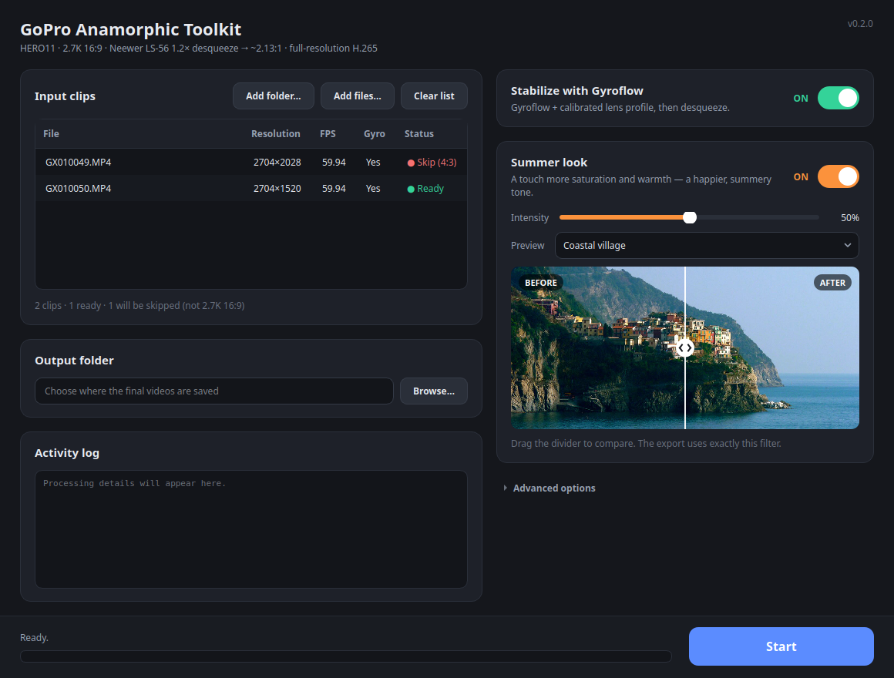

# GoPro Anamorphic Toolkit (gat)

A Linux tool that turns the original clips of a **GoPro HERO11 Black** shot
with the **Neewer LS-56 1.2x** anamorphic lens (unofficial) into ready-to-watch,
full-resolution cinematic videos.



It handles **one format only: 2.7K 16:9 clips** (2704×1520). The calibrated lens
profile is valid only for that format, so anything else (e.g. 4:3) is **flagged
and skipped**, never processed.

The pipeline:

1. **Stabilization** (optional, on by default) with **Gyroflow**, using the raw
   gyroscope data stored in the file (GPMF track) and a **calibrated lens
   profile** — not the GoPro's internal HyperSmooth, which wobbles with this
   unofficial lens.
2. **Anamorphic desqueeze** 1.2x → ~2.13:1 cinematic frame.
3. **Summer look** (optional, off by default): a touch more saturation and
   warmth, with adjustable intensity and a live before/after preview.
4. **Export** at **full resolution** (~3244×1520, no downscale) as high-quality
   H.265 (CRF 18, preset slow, `hvc1` tag for Apple/TV compatibility).

> **Honest note on quality:** the desqueeze, the stabilization and the optional
> look all *resample* the image, so the output is *near-original* — very high
> quality at full resolution — but not bit-identical to the source. The low CRF
> avoids adding visible losses on top of that resampling.

---

## Requirements

- **Linux** with **Python ≥ 3.10**.
- **ffmpeg / ffprobe** with `libx265`:
  ```bash
  sudo apt install ffmpeg
  ```
- **Gyroflow** (for stabilization only): download the AppImage from
  <https://gyroflow.xyz>. It is **not bundled** with this project. The toolkit
  finds it on `PATH`, in `~/Applications/`, `~/.local/bin/` or `/opt/gyroflow/`,
  or you can point to it (GUI: *Advanced options* → *Gyroflow app*; CLI:
  `--gyroflow`).
- A **calibrated lens profile** for your camera + lens + settings. The bundled
  `src/gat/resources/neewer_lens.json` is the author's profile (HERO11 + Neewer
  LS-56, 2.7K 16:9 Wide); for best results calibrate your own (see
  [Calibrating your lens](#calibrating-your-lens)).

## Installation

```bash
git clone https://github.com/bianchi-john/GoProNeewer1.2xAnamorphic.git
cd GoProNeewer1.2xAnamorphic
python3 -m venv .venv && source .venv/bin/activate
pip install -e ".[gui]"     # installs the `gat` CLI and the `gat-gui` app
```

Drop `[gui]` (`pip install -e .`) if you only need the command line.

## Recommended shooting settings

Verified in the field:

- **2.7K 16:9** (`2704x1520`) — the only supported format.
- **Wide** lens (Gyroflow corrects the fisheye distortion with the profile).
- **HyperSmooth OFF**.
- Always use the **ORIGINAL files from the SD card**: the gyro data (GPMF) is
  lost when a file goes through apps/editors that re-encode it.

## Usage — GUI

```bash
gat-gui
```

1. **Input clips** — *Add folder…*, *Add files…*, or drag & drop. The list shows
   resolution, fps, gyro track and a status: **Ready**, or **Skip** (with the
   reason in the tooltip) for anything that is not 2.7K 16:9.
2. **Stabilize with Gyroflow** — the big ON/OFF switch. ON = Gyroflow + the
   calibrated lens profile, then desqueeze. OFF = desqueeze + export only.
3. **Summer look** — switch it ON to reveal the intensity slider and the
   before/after preview. Drag the divider to compare; pick a bundled sample
   image or a frame of one of your clips.
4. **Output folder** — where the final videos are written.
5. **Start** — always visible at the bottom, with progress and status. The
   **Activity log** states for every clip whether stabilization and the Summer
   look were applied.

*Advanced options* (collapsed by default): Gyroflow path, H.265 CRF, x265
preset.

## Usage — CLI

```bash
# Stabilize + desqueeze at full resolution (high-quality defaults)
gat /path/to/original_clips /path/to/output

# Desqueeze only (no Gyroflow)
gat input/ output/ --no-stabilize

# Add the Summer look (intensity 0-100, default 50)
gat input/ output/ --summer-look --look-intensity 60

# Use a specific Gyroflow and lens profile
gat input/ output/ --gyroflow ~/Applications/Gyroflow.AppImage --calibration my_profile.json

# Inspect only: metadata + validation, nothing is processed
gat input/ --probe
```

Run `gat --help` for every option; add `--verbose` to also log the exact
ffmpeg/Gyroflow commands and Gyroflow's own output (handy for troubleshooting).
Advanced encoder options are already set to
high-quality values: `--crf` (default 18), `--preset` (default slow),
`--squeeze` (1.2), `--zoom` (`auto`: 1.0 with stabilization — Gyroflow already
crops the edges — otherwise a ~1.2x anti-vignetting crop).

### Output

Input **2.7K 16:9** (2704×1520) → desqueeze 1.2x → **3244×1520** at full
resolution (cinema ~2.13:1) when stabilized, or 2702×1266 without stabilization
(the anti-vignetting crop). Files are named `<clip>_anamorphic_<W>x<H>.mp4`.

### Summer look

A single `lutyuv` pass on the YUV planes: chroma is scaled around neutral
(saturation, up to +30% at intensity 100) and nudged toward yellow/red
(warmth). Even at 100% it stays a gentle summer tint, by design. The GUI preview
runs **the exact same ffmpeg filter** as the export, so what you see is what you
get.

### Configuration

Defaults can be saved to `~/.config/gat/config.json`:

```bash
gat input/ output/ --crf 16 --preset slower --summer-look --save-config   # saves and exits
```

Command-line options always override the config file.

## AppImage (no Python needed)

The app can be shipped as a single **AppImage** that bundles Python, PySide6,
`gat`, the default lens profile and the preview images. **Gyroflow and ffmpeg
are NOT bundled**: they remain external requirements.

Build it:

```bash
pip install python-appimage
pip install -e .                      # makes `gat` importable (local+gat)
packaging/build_appimage.sh          # -> packaging/GoProAnamorphic-x86_64.AppImage
```

Run it:

```bash
./GoProAnamorphic-x86_64.AppImage                    # GUI
./GoProAnamorphic-x86_64.AppImage cli input/ output/ # CLI
```

> The AppImage needs **glibc ≥ 2.28** (any recent distro), **ffmpeg** on the
> system and, for stabilization, the **Gyroflow AppImage**.

## Calibrating your lens

The bundled profile was calibrated for the author's *HERO11 + Neewer LS-56 1.2x
+ Wide 2.7K 16:9* (reprojection error ~1.27). For your own setup:

1. Record a **checkerboard** video in the same mode (2.7K 16:9 Wide,
   HyperSmooth off) and open it in the Gyroflow **Lens Calibrator**.
2. Set **Input horizontal stretch = 1.2**.
3. Export the `.json` profile and use it with `--calibration my_profile.json`
   (or replace `src/gat/resources/neewer_lens.json`).

## Expected behavior

### OpenCL / CUDA errors on AMD hardware

On some machines (e.g. AMD Ryzen laptops) Gyroflow repeatedly prints:

```
Failed to initialize OpenCL Platform::list ...
Cannot load libcuda.so.1
libamfrt64.so.1 ...
```

**These are not fatal.** Gyroflow falls back to `wgpu` and completes the render.
The toolkit recognizes them, collapses them into a single log line ("ignored N
harmless GPU-backend messages") and judges success from the `_stabilized` file
and the `Done in …s` line.

### AppImage without FUSE

When FUSE is not available, the toolkit runs the Gyroflow AppImage with
`APPIMAGE_EXTRACT_AND_RUN=1` (extract and run, no mount), so it still works.

## Known limitations

- Tested with a GoPro **HERO11 Black** + **Neewer LS-56 1.2x** only. Other
  combinations need their own lens profile.
- Only **2.7K 16:9** clips are processed; 4:3 and other formats are skipped.
- The desqueeze assumes 1.2 horizontal / 1.0 vertical squeeze.
- Linux only (for now).

## Development

```bash
pip install -e ".[gui,dev]"
pytest -q
```

Real test clips live in `gopro/` and are versioned with **Git LFS**
(`git lfs install && git lfs pull` to download them):

| Path                            | Content                                          |
|---------------------------------|--------------------------------------------------|
| `gopro/169/GX010050.MP4`        | 2.7K 16:9 Wide clip with strong intentional shake |
| `gopro/43/GX010049.MP4`         | 2.7K 4:3 clip — must be flagged and skipped      |
| `gopro/calibration/GX010051.MP4`| checkerboard calibration video                   |
| `gopro/gopro_anamorphic.sh`     | original bash script (historical reference)      |

The design and later decisions are documented in
[PROJECT_SPEC.md](PROJECT_SPEC.md).

## License and credits

[MIT](LICENSE) © 2026 John Bianchi.

- Gyroflow is a separate project (GPLv3) and is **not included**: download it
  yourself.
- The Summer look sample images are **CC0** photos from Wikimedia Commons — see
  [src/gat/resources/previews/CREDITS.md](src/gat/resources/previews/CREDITS.md).
